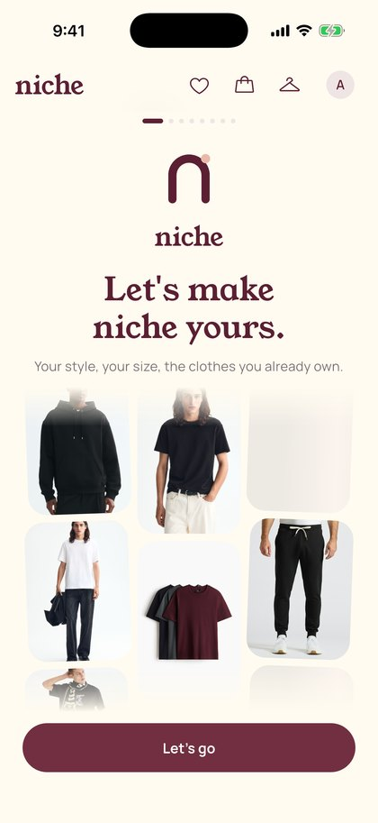
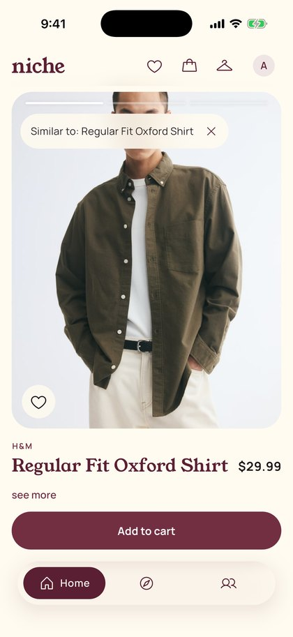
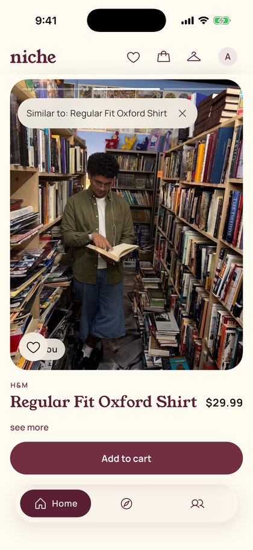
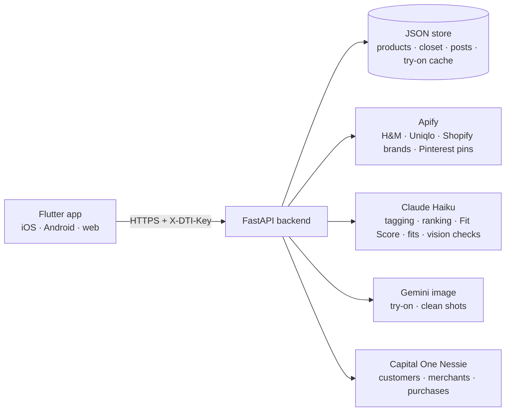

<p align="center">
  
</p>

<h1 align="center">niche</h1>

<p align="center"><strong>Your clothes. Your fit. Your niche.</strong></p>

<p align="center">
  A shopping and styling app built around the closet you already own.<br>
  Real clothes from 8 stores, in your size, tried on <em>you</em>, and paid for in one cart.
</p>

<table align="center">
  <tr>
    <td align="center"></td>
    <td align="center"></td>
    <td align="center"></td>
  </tr>
  <tr>
    <td align="center"><sub><b>Welcome</b><br>your style, your size, your closet</sub></td>
    <td align="center"><sub><b>Home</b><br>one real product per screen</sub></td>
    <td align="center"><sub><b>On you</b><br>the same shirt, on your own photo</sub></td>
  </tr>
</table>

Niche is a shopping and styling app built around the closet you already own. You swipe real, in-stock clothes from 8 stores and see each piece on your own photo next to the things you already own that go with it. Then you check out across every store in one cart. Your closet is built from your outfit photos, and you share fits with friends or everyone.

Built at **Cal Hacks 13.0** (Oct 2026).

---

## Features

- **Home (reels).** One product per screen, in your size and in stock, from H&M, Uniqlo, Princess Polly, Edikted, Brandy Melville, True Classic, Kith and Stüssy. Each post has three slides:
  1. the item;
  2. **on you**, your own photo with just that garment swapped in, pre-rendered before you scroll;
  3. a 2×2 grid of **closet picks**, pieces you own that go with it.

  Every card says why it was picked. Heart or double-tap to like; Add to cart is the only other button.
- **Discover.** A Pinterest-style board mixing real outfit pins, products and Inspo posts, with style chips, search, and photo search. **Similar** on any pin shows your own closet first, then pieces to buy.
- **Closet from photos.** Post outfit photos and Niche:
  - splits each one into pieces, including partly hidden layers and accessories;
  - makes a white-background shot of each piece, checked to match its label;
  - only names a brand when a logo is visible;
  - merges the same piece across outfits.

  **Outfits** keep the photos you wore them in, each with an editable nickname and a **Fit Score** (0–100 on eight stylist criteria, given for a named style). **Create 3 fits** takes the occasion in your own words and builds three season-checked outfits from your closet only.
- **Inspo.** Outfit-of-the-day posts visible to Friends or Everyone. Add friends by `@handle` or friend code, react with 🔥 😍 👀 💯, and comment. **Find similar look** breaks a post into its pieces: what you already own, then what to buy.
- **One cart, every store.** Checkout makes one **Capital One Nessie** purchase per store. It handles sold-out items (nothing is charged) and lets you retry a failed store without double-charging. The **Niche Card** shows your Nessie balance and purchases live.
- **Also:** Google sign-in, onboarding with photo-based measurements, sizing from your measurements (men's, women's, unisex), light and dark mode, iOS, Android and web.

## Architecture



The app never calls outside services directly. Every key stays on the server, and clients authenticate with a shared `X-DTI-Key` header. Google sign-in is optional.

## How the AI works

**Recommendations (Claude + rules).**
- **Rules first.** A rule-based shortlist removes style clashes (athletic ↔ formal, big formality gaps) and same-category pairings. Claude re-ranks the top 20 and writes the reason, blended 50/50 with the rule score, with deterministic tie-breaks.
- **Deterministic calls.** A strict JSON schema per prompt with closed vocabularies, one retry, then a rules fallback. Gemini runs at temperature 0 with a fixed seed; Claude Haiku 5.5 only accepts its default sampling, so the schema check is its guard.
- **Hard validators** on every card, for example no reason may mention a closet item you don't own.
- **Measured.** [`docs/rec-eval.md`](docs/rec-eval.md) runs 20 cases × 3 runs against the real model:

| Metric | Before | After |
| --- | --- | --- |
| Top-5 stability (Jaccard) | 0.61 | **0.75** |
| Style-clash pairings | 11% | **0%** |
| Same-category pairings | 19% | **0%** |
| Cost per ranking | | ≈ $0.001 |

**Try-on (Gemini).**
- **Source photo.** We pick the user's best real photo for the product: one that already shows a garment of the same category, with matching warmth and layers, so shorts never go onto a coat photo.
- **In-place edit.** Gemini swaps only that garment, true to size. Face, pose, background and every other piece stay.
- **Labelled images.** Each image in the request is labelled inline ("IMAGE 1", "IMAGE 2 (reference only)"), so the model edits the right photo.
- **Guard.** A perceptual-hash check rejects any output that looks more like the store's reference photo than the user, then retries once. If it still fails, the app shows "try-on unavailable · Retry", never a fake.
- **Prefetch.** A small background pool renders the next posts with in-flight de-duplication and a per-user daily cap.

**Closet clean shots.** The request names the exact piece ("white wired earbuds, accessory"). A Claude vision check confirms the result shows only that piece. If not, it retries, then renders from the label alone, then falls back to a crop.

**Plain rules (free, instant):** sizing, colour matching, warmth/season, duplicate detection.

## Brand

The logo is an arch (a niche: a small space that's yours) with a hanger-hook dot. Type is Young Serif and Manrope; colours are merlot `#5B1F33` on cream `#FFFBF0`.

## Design

The original app wireframe: [WireframeSketch (made with Notability).pdf](<WireframeSketch (made with Notability).pdf>).

## Tech stack

| Layer | Tools |
| --- | --- |
| App | Flutter / Dart, Young Serif + Manrope, `http`, `image_picker`, Google Sign-In |
| Backend | Python, FastAPI, Pydantic, Uvicorn, httpx, Pillow |
| AI | Anthropic Claude (Haiku), Google Gemini (text fallback + image) |
| Data | Apify actors (`gauzy_penguin/HM-Product-Scraper`, `abotapi/uniqlo-com-scraper`, `autofacts/shopify`, a Pinterest scraper) |
| Payments | Capital One Nessie API |
| Testing | pytest, flutter_test (incl. golden tests) |
| Hosting (demo) | Mac + Cloudflare quick tunnel |

## Repo layout

```
app/        Flutter app (lib/core = API + models, lib/features = screens)
backend/    FastAPI service (app/ai = AI pipelines, app/commerce = catalog, cart, checkout), scripts/, seed/, tests/
docs/       Technical docs: AI write-up, schema, rec eval, Google auth, Devpost, demo script
frontend/   Early design specs and mock data
```

## Run it locally

**Backend**

```bash
cd backend
python -m venv .venv && source .venv/bin/activate
pip install -r requirements.txt
cp .env.example .env        # fill in the key names below; MOCK_AI=1 runs without AI keys
python -m scripts.load_products
uvicorn app.main:app --host 127.0.0.1 --port 8000
```

`.env` keys, all listed in [`backend/.env.example`](backend/.env.example):
- **Service keys:** `ANTHROPIC_API_KEY`, `GEMINI_API_KEY`, `APIFY_TOKEN`, `NESSIE_API_KEY`, `API_SHARED_KEY`, `PUBLIC_BASE`, `GOOGLE_CLIENT_IDS`.
- **Tuning:** `CLAUDE_MODEL`, `GEMINI_IMAGE_MODEL`, `AI_BUDGET_USD`, `MAX_TRYONS`, `PREFETCH_PER_USER_DAY`, `MOCK_AI`.

Never commit `.env`.

**App**

```bash
cd app
flutter pub get
flutter run --dart-define=DTI_API_BASE=http://127.0.0.1:8000 --dart-define=DTI_API_KEY=<your API_SHARED_KEY>
```

## Tests

```bash
cd backend && .venv/bin/pytest -q   # ~780 tests, no keys needed (AI is faked)
cd app && flutter analyze && flutter test   # ~200 tests incl. goldens
```

## Team & roles

| Who | Role |
| --- | --- |
| **Adam Abid** (`ACWArob`) | AI and infrastructure. Built the Claude and Gemini pipelines: product and closet tagging, feed ranking with its eval harness, try-on, clean shots, Fit Score, Create 3 fits, friends. Also ran backend hosting and the app core (`app/lib/core`), and in the final sprint the app screens (closet, Inspo, fits). |
| **Nabil Djaber** (`latrael`) | Commerce backend. Built the Apify catalog ingest (8 stores + Pinterest pins), products, feed and cart routes, Capital One Nessie checkout and the Niche Card, Google sign-in, and the Discover board. |
| **Ryan Djaber** (`ryantheribosome`) | Design and frontend. Built the Flutter design system and visual overhaul, reels Home, onboarding, and the Discover and Inspo screens. |
